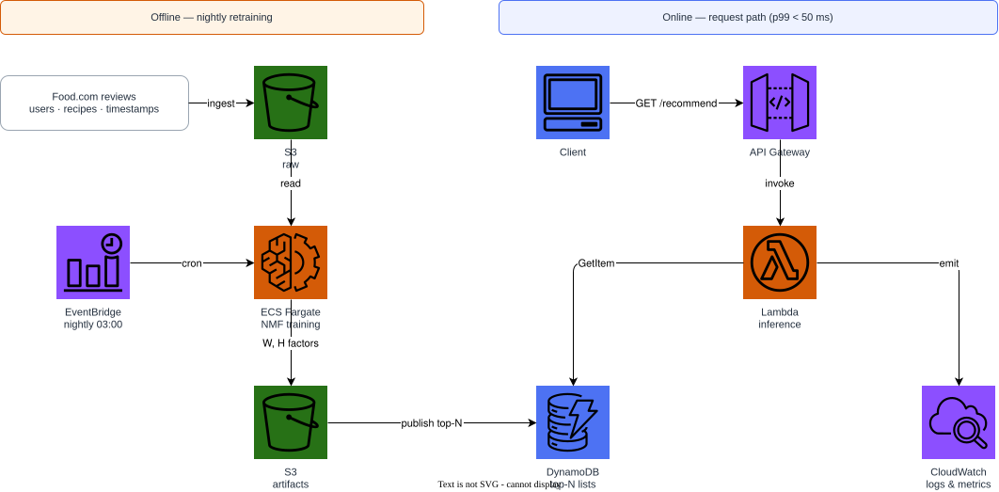
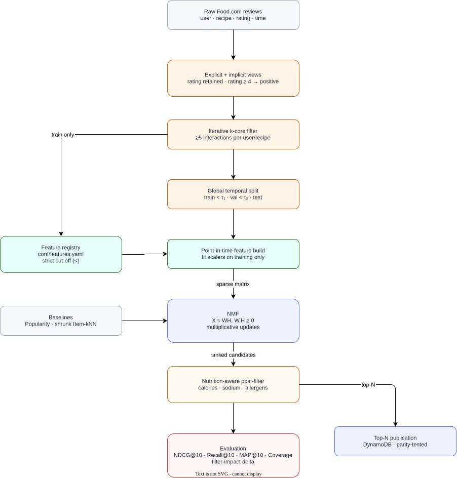

# Food.com Classical NMF Recipe Recommender

Classical Non-negative Matrix Factorization (NMF), hand-written with
multiplicative update rules in NumPy, for ranking Food.com recipes against
real user review timestamps, combined with a post-hoc nutrition-aware
filter. No neural networks, no deep-learning framework, no
gradient-descent-trained embeddings.

---

## Why NMF for recipes

Unlike signed factorizations (SVD) or pairwise-ranking embeddings (BPR), NMF
constrains both factor matrices to be non-negative:

$$X \approx WH, \quad W \ge 0,\ H \ge 0.$$

The latent components are therefore additive and interpretable as
"flavor/ingredient profiles" rather than opaque signed directions — a
component is a non-negative mixture of recipes, and a user is a non-negative
mixture of components. That is a natural fit for a recipe catalogue, where
combining collaborative signal with hard domain constraints (calories,
sodium, allergens) is a first-class requirement, not an afterthought. The
post-hoc nutrition filter sits entirely outside the factorization, so a
dietary constraint holds regardless of what the collaborative model learned.

---

## Dataset

[Food.com Recipes and Reviews](https://www.kaggle.com/datasets/irkaal/foodcom-recipes-and-reviews)
(Kaggle ref `irkaal/foodcom-recipes-and-reviews`): recipes with ingredients
and nutrition facts, and roughly 1.4M timestamped user reviews/ratings.
Reviews carry a real event timestamp, so — like `movielens-svd-ranking` and
unlike `anime-bpr-recommender` — this project evaluates primarily on a
**global temporal split**, with leave-last-one-out reported as a secondary,
comparison protocol.

---

## Quick start

```bash
python -m venv .venv && source .venv/bin/activate
pip install -e ".[dev]"

# Generate a synthetic fixture with the same schema (no Kaggle account needed)
python scripts/download_data.py --synthetic

# Build the point-in-time feature tables
python scripts/build_features.py

# Train, evaluate, recommend
python -m recommender.cli train
python -m recommender.cli evaluate --nutrition-filter
python -m recommender.cli recommend --user-id 1 --k 10 --nutrition-filter --max-calories 500
```

The real dataset (requires `KAGGLE_USERNAME`/`KAGGLE_KEY`):

```bash
python scripts/download_data.py --kaggle
```

---

## Architecture

### AWS deployment



### Recommendation flow



Both diagrams are editable: [`docs/aws-architecture.drawio`](docs/aws-architecture.drawio)
and [`docs/recommendation-architecture.drawio`](docs/recommendation-architecture.drawio).

Regenerate them with:

```bash
python -m venv .diagram-venv && .diagram-venv/bin/pip install drawpyo
.diagram-venv/bin/python scripts/generate_diagrams.py
docker run --rm -v "$PWD/docs":/data -w /data rlespinasse/drawio-export \
  -f svg -o . --output-mode relative --remove-page-suffix .
docker run --rm -v "$PWD/docs":/data -w /data rlespinasse/drawio-export \
  -f png -o . --output-mode relative --remove-page-suffix .
# Never pass -t/--transparent to the PNG export above: it drops the white
# background and the diagram turns invisible on GitHub's light theme.
docker run --rm -v "$PWD/docs":/data alpine chown -R "$(id -u):$(id -g)" /data
python scripts/generate_diagrams.py --patch-svg-background
```

---

## Models

| Model | Scorer | Notes |
|---|---|---|
| `NMF` | $X \approx WH$, $W,H \ge 0$ | Multiplicative-update NMF, hand-written |
| `ItemKNN` | shrunk cosine co-occurrence | Strong neighbourhood baseline |
| `Popularity` | global interaction count | Non-personalised floor |
| `Random` | deterministic random ordering | Sanity-check floor |

---

## Feature engineering

Features are declared in [`conf/features.yaml`](conf/features.yaml) and
implemented in `src/recommender/features/`. Every aggregate is computed
**point-in-time** against a real timestamp: only interactions strictly
before the prediction time contribute.

| Feature | Family | Point-in-time | Fit scope |
|---|---|:---:|---|
| `user_activity_count` | user | | train_only |
| `user_mean_rating` | user | | train_only |
| `user_tenure_days` | user | | train_only |
| `user_recency_days` | context | ✓ | train_only |
| `item_popularity_rank` | item | | train_only |
| `item_trailing_popularity` | statistical | ✓ | train_only |
| `item_category_tokens` | text | | catalogue |
| `item_calories` | item | | catalogue |
| `item_sodium_mg` | item | | catalogue |

The full rationale for each feature is in
[`conf/features.yaml`](conf/features.yaml) and reproduced in the paper
(Table 1), generated by `scripts/export_feature_tables.py` so the write-up
cannot drift from the declared spec.

### Leakage controls

`tests/test_features_leakage.py` asserts that:

1. Injecting a review **after** the cut-off does not change any feature.
2. Popularity and encoding tables are fitted on the training partition only.
3. Shuffling the user-item association collapses trailing-popularity signal.

---

## Evaluation

Global temporal split with a configurable cut-off quantile, plus
leave-last-one-out for comparability with published notebooks. Candidates are
the full catalogue minus each user's training history.

Results are generated by `python scripts/export_results_table.py`, which
writes both `paper/tables/results.tex` and the Markdown block below, so the
README, the paper, and the code cannot drift apart.

<!-- RESULTS:START -->
| Model | NDCG@10 | Recall@10 | MAP@10 | Coverage |
|---|---:|---:|---:|---:|
| NMF | 0.1270 | 0.1497 | 0.0719 | 0.3507 |
| ItemKNN | 0.1378 | 0.1969 | 0.0799 | 0.4970 |
| Popularity | 0.1040 | 0.1637 | 0.0549 | 0.0301 |

| Nutrition filter impact (NMF, k=10, pool=50) | Value |
|---|---:|
| Mean fraction of candidates removed | 0.7066 |
| NDCG@10 unfiltered | 0.1270 |
| NDCG@10 filtered | 0.0785 |
| NDCG@10 delta | -0.0485 |
<!-- RESULTS:END -->

---

## Infrastructure

```bash
docker compose up -d
terraform -chdir=terraform init
terraform -chdir=terraform validate
terraform -chdir=terraform apply -auto-approve
terraform -chdir=terraform destroy -auto-approve
docker compose down
```

Terraform targets the local Floci AWS emulator at `http://localhost:4566`
with dummy credentials, so the default path costs nothing and needs no AWS
account. Real-AWS deployment is documented in
[`terraform/README.md`](terraform/README.md).

### Cost and cleanup

Floci is a local emulator: `docker compose up -d` and `terraform apply`
against it cost nothing. When `use_floci = false` targets real AWS, the
billed resources are an S3 bucket (versioned, lifecycle-managed), a
pay-per-request DynamoDB table, one small Lambda, and an EventBridge rule —
all destroyed by `terraform destroy -auto-approve`. Nothing here runs an
always-on compute instance.

---

## Paper

Methodology, equations, and results are in [`paper/main.pdf`](paper/main.pdf).

```bash
make -C paper tables   # regenerate tables from the code
make -C paper docker   # build the PDF in a container
```

---

## License and data

Code is MIT licensed. The dataset is distributed by its Kaggle maintainer
under its own terms and is **not** redistributed here;
`scripts/download_data.py` fetches it on demand or generates a synthetic
fixture with the same schema.
